# Design Document: Transcript Risk Scoring

## Overview

This design adds an advisory-only risk pipeline to the existing two-person call application. The persistent Python LiveKit worker remains responsible for final-turn speech recognition, optional Urdu/Punjabi-to-English translation, and authenticated delivery. The Next.js/TypeScript side becomes the sole authority for input acceptance, session ordering, durable revisions, context construction, deterministic checks, contextual-model calls, result validation, aggregation, advisory generation, persistence, and participant delivery.

No application code is changed by this design phase.

The central rule is: **Python produces attributed evidence; TypeScript decides what evidence is accepted and what assessment is current.** A contextual model never receives credentials, tools, application handles, or authority to request actions. All outputs are evidence-backed advice; the feature cannot end a call, contact a person or service, report a participant, or affect a transaction.

## Existing System Fit

The design extends these existing boundaries:

- `worker/transcriber.py` already runs one persistent LiveKit agent, selects `deepgram/nova-3` for English and `cartesia/ink-whisper` for Urdu/Punjabi, translates completed non-English turns, and retries `POST /api/internal/transcripts`.
- `app/api/internal/transcripts/route.ts` already authenticates the Python worker with a timing-safe bearer-secret comparison and persists final transcript data.
- `lib/sessions.ts` already signs room-scoped invitations and binds a call language to them.
- `lib/livekit.ts` already places the configured language in `RoomAgentDispatch.metadata`.
- `lib/call-logs.ts` already abstracts local JSONL versus private Vercel Blob transcript storage.
- `app/api/call-logs/[roomId]/route.ts` already enforces room-scoped archive access.
- `app/call/[roomId]/page.tsx` already polls that archive API every two seconds for Urdu/Punjabi translation updates.
- Tests already use Node's built-in test runner and can exercise TypeScript directly without LiveKit.

The existing call-log files remain a human-readable archive. They are not sufficient as the risk system of record because file append and private Blob overwrite do not provide the cross-instance transaction, uniqueness, monotonic sequence, outbox, or compare-and-set semantics required by this feature.

## Responsibility Decision

### Python responsibilities

`worker/transcriber.py` owns only operations adjacent to audio and the LiveKit SDK:

1. Observe a completed speaking turn and set `isFinal: true`.
2. Capture `eventAt` immediately when the final turn is emitted, before translation latency.
3. Generate one stable `segmentId` before translation and reuse the same ID and payload for all HTTP retries.
4. Report the configured source language and exact STT provider/model pair.
5. Preserve STT text exactly; do not trim, normalize, translate in place, or assign risk meaning.
6. Forward upstream STT confidence when the SDK exposes a finite value; otherwise omit it.
7. For Urdu/Punjabi, request an English translation and attach complete translation provenance when successful.
8. Post the submission through the authenticated internal channel with its room-scoped ingestion association.

Python does **not** assign sequence numbers, build cross-speaker context, run scam rules, invoke the contextual risk model, aggregate scores, map advice, decide freshness, or deliver alerts. Those operations require a single durable authority spanning both participant-specific `AgentSession` objects and potentially many Next.js instances.

### TypeScript responsibilities

TypeScript owns all security- and state-sensitive logic:

- channel and room-association authentication;
- schema and source validation;
- durable session lookup, language checks, deduplication, sequence assignment, and revision advancement;
- immutable evidence and provenance persistence;
- bounded context and fingerprinting;
- deterministic and contextual detection;
- citation and result validation;
- separate scam, harm, and transcript-confidence dimensions;
- versioned aggregation and advisory mapping;
- stale-result suppression, degraded-state recording, and participant delivery.

With the exception of repositories, queue/model adapters, and API handlers, risk modules are pure TypeScript functions. This makes the complete scoring path testable without a call, LiveKit, storage service, or real model.

## Architecture

```mermaid
flowchart LR
    LK[LiveKit final STT turn] --> PY[Python evidence producer]
    PY -->|Bearer credential + session association + WorkerFinalSegment| IN[Next.js internal transcript intake]
    IN --> AUTH[Channel and session authentication]
    AUTH --> VAL[Envelope validator]
    VAL --> TX[Transactional accept/deduplicate/sequence]
    TX --> ARCHIVE[Existing call-log archive projection]
    TX --> OUTBOX[Durable risk outbox]
    OUTBOX --> RUNNER[TypeScript risk job runner]
    RUNNER --> CTX[Bounded context builder]
    CTX --> DET[Deterministic detector]
    CTX --> MODEL[Contextual detector adapter]
    DET --> RVAL[Result and evidence validator]
    MODEL --> RVAL
    RVAL --> AGG[Risk aggregator]
    AGG --> ADV[Advisory generator]
    ADV --> COMMIT[Revision/fingerprint compare-and-set]
    COMMIT --> STORE[Immutable assessments and latest pointer]
    STORE --> GET[Authorized call-log API]
    GET --> UI[Polling call UI and call-log UI]
```



### Component boundaries

| Component | Runtime | Side effects | Contract |
|---|---|---|---|
| `FinalTurnProducer` | Python worker | STT/translation model, HTTP | Produces exact source and optional translation evidence |
| `TranscriptIntakeRoute` | Next.js Node | HTTP, repository | Authenticates, stamps trusted fields, invokes acceptance transaction |
| `InputValidator` | TypeScript pure | None | Returns accepted value or machine-readable rejection |
| `RiskRepository` | TypeScript port | Transactional store | Sessions, accepted segments, revisions, outbox, assessments, audits |
| `CallLogProjector` | TypeScript adapter | local files/private Blob | Maintains the existing transcript archive after durable acceptance |
| `ContextBuilder` | TypeScript pure | None | Orders, bounds, labels, and fingerprints evidence |
| `DeterministicDetector` | TypeScript pure | None | Applies a versioned high-precision rule catalog |
| `ContextualDetectorPort` | TypeScript port | one model request | Requests strict JSON with no tools or other capabilities |
| `ResultValidator` | TypeScript pure | None | Validates whole contextual output and individual deterministic matches |
| `RiskAggregator` | TypeScript pure | None | Applies versioned maxima/floors across separate dimensions |
| `AdvisoryGenerator` | TypeScript pure | None | Produces only display/persist advisory view data |
| `RiskJobRunner` | TypeScript worker/queue handler | repository/model | Runs an idempotent assessment for an immutable revision |
| `AssessmentQuery` | Next.js Node | repository | Returns only an authorized room's current or pending assessment state |

## End-to-End Flow

### 1. Session registration and worker association

The current signed invitations prove participant access but do not constitute a durable session registry. At room creation, the future implementation must transactionally create a `RiskSession` record containing `sessionId`, `language`, `createdAt`, `expiresAt`, `highestSequence = 0`, `latestRevision = 0`, and no latest assessment.

When `makeParticipantToken` creates `RoomAgentDispatch.metadata`, TypeScript adds a signed, short-lived `ingestionAssociation` claim containing:

```ts
type IngestionAssociationClaims = {
  version: 1;
  sessionId: `call-${string}`;
  language: "en" | "ur" | "pa";
  expiresAt: string;
  nonce: string;
};
```

The claim is signed server-side and is scoped to exactly one registered session and language. The Python worker receives it from trusted dispatch metadata and echoes it in `X-Transcript-Session`. It cannot mint or alter association claims. The route requires both:

- `Authorization: Bearer <TRANSCRIPT_WORKER_SECRET>` for channel authentication; and
- a valid `X-Transcript-Session` claim whose session, language, expiry, and registry record agree.

A valid global worker secret without a matching room association is insufficient. Credential checks occur before JSON parsing or transcript logging. Secrets and association tokens are never included in assessment records or model input.

### 2. Python finalized-segment production

`on_user_turn_completed` captures the following transport DTO. It captures `segmentId` and `eventAt` before awaiting translation so retries and translation latency cannot change identity or speech-event time.

```py
WorkerFinalSegment = {
    "schemaVersion": 1,
    "sessionId": room_id,
    "segmentId": stable_uuid,
    "speaker": "caller" | "receiver",
    "isFinal": True,
    "eventAt": final_turn_time_iso,
    "sourceText": exact_stt_text,
    "sourceLanguage": "en" | "ur" | "pa",
    "transcriptionProvider": "deepgram" | "cartesia",
    "transcriptionModel": "nova-3" | "ink-whisper",
    "transcriptConfidence": optional_float,
    "translation": None | {
        "text": exact_english_model_output,
        "sourceSegmentId": stable_uuid,
        "sourceLanguage": "ur" | "pa",
        "targetLanguage": "en",
        "provider": "livekit-inference",
        "model": configured_translation_model,
        "translatedAt": translation_completion_time_iso,
    },
}
```

English submissions omit `translation`. Urdu/Punjabi translation failure is represented by absence, not invented text. Code-switching remains in the exact source string and does not change the configured session language. The worker may reject empty model output as no translation, but it may not alter a non-empty source or translation string.

### 3. Authenticated intake and trusted envelope construction

`POST /api/internal/transcripts` evolves from the current loose transcript body to the versioned transport DTO above. After both credentials pass, the route:

1. Parses JSON with a request-size limit.
2. Sets `receivedAt` from an injected server clock; it never trusts a client-supplied receipt time.
3. Validates required fields, UUID/room formats, ISO timestamps, enum values, finality, per-field maximum lengths, and confidence. Text length and all later offsets are measured in Unicode code points, not JavaScript UTF-16 code units.
4. Accepts only `en/deepgram/nova-3` and `ur|pa/cartesia/ink-whisper`.
5. Verifies the persisted session exists, the association is for that session, and all three language values—session, association, submission—match.
6. Verifies `eventAt <= receivedAt + 60 seconds`.
7. Validates complete translation provenance and `translation.sourceSegmentId === segmentId`.

A failure creates a rejection audit with the safe identifiers, `state: "rejected"`, and one machine-readable reason. It does not invoke either detector or persist untrusted text as accepted evidence. Authentication failures remain generic HTTP 401/403 responses and do not disclose session existence.

### 4. Atomic deduplication, ordering, and outbox creation

For a valid submission, the route computes a `submissionDigest` over canonical JSON of all exact content and provenance fields. Inside one repository transaction, locking the session row:

1. Look up `(sessionId, segmentId)`.
2. If an existing digest is identical, return its stored intake receipt and current processing reference. Do not increment sequence/revision, rewrite evidence, project another call-log line, or enqueue another job.
3. If the ID exists with a different digest, record `duplicate_conflict` and reject.
4. Assign `sequence = highestSequence + 1` at authenticated ingestion. Python never supplies trusted ordering.
5. Advance `sessionRevision = latestRevision + 1`.
6. Persist the immutable accepted segment and all provenance.
7. Update the session high-water marks.
8. Insert an outbox job keyed by `(sessionId, sessionRevision)`.
9. Commit all operations together.

The resulting internal `RiskInputEnvelope` contains the route-owned `receivedAt`, `sequence`, and `sessionRevision`. A repository import or replay path that accepts an explicit sequence applies the same high-water rule and rejects a nonduplicate sequence at or below the accepted maximum as `stale_sequence`.

The route returns HTTP 202 with `{ accepted: true, duplicate, segmentId, sequence, sessionRevision, processingStatus: "pending" }`. The Python retry loop treats any successful 2xx receipt as delivered. Existing call-log projection occurs after acceptance and is retryable by segment ID; projection failure does not roll back accepted risk evidence and is recorded for repair.

### 5. Durable asynchronous execution

A transactional outbox dispatcher sends jobs to an at-least-once TypeScript queue. The production implementation must use a store and queue with cross-instance transaction/uniqueness semantics; the local implementation may use a file-backed repository and an in-memory drain method for development/tests. A fire-and-forget promise or process-local `Map` is not a production queue.

Each job is immutable:

```ts
type RiskJob = {
  jobVersion: 1;
  sessionId: string;
  sessionRevision: number;
  triggerSegmentId: string;
  attempt: number;
};
```

The runner claims jobs idempotently. Before model invocation it loads the exact accepted snapshot through `sessionRevision`. If a newer revision already exists, it may record `superseded_before_analysis` and skip the expensive call. If a newer revision arrives while analysis is in flight, the completed result is still validated and then rejected from the latest pointer as stale. At-least-once delivery cannot create duplicate assessments because assessment identity is `(sessionId, revision, contextFingerprint, pipelineVersion)`.

### 6. Bounded context

For revision `R`, `ContextBuilder` loads only segments with `acceptedRevision <= R`, then:

1. Sorts by ascending `sequence`.
2. Takes the 20 most recent segments.
3. Uses the newest selected segment's `eventAt` as the anchor and removes segments more than 10 minutes older.
4. Counts Unicode code points across each retained `sourceText` plus present `translation.text`.
5. While the total exceeds 20,000, removes the oldest whole segment. It never truncates a field because truncation would complicate provenance and citation identity.
6. Preserves source and translation as distinct labeled fields.
7. Returns `insufficient_context` if all retained source fields are empty or Unicode whitespace.

A single valid segment above the per-field schema maximum never reaches this stage. Therefore whole-segment eviction can always satisfy the 20,000-character context bound without retaining a partial segment.

The fingerprint is SHA-256 over length-delimited canonical JSON containing the context schema version, session ID, revision, and ordered records of `segmentId`, `sequence`, unchanged source field, and unchanged translation field or `null`. It does not hash canonical matching text. Equal evidence snapshots produce equal lowercase hex fingerprints; changing identity, order, revision, source, or translation changes the preimage.

### 7. Canonical text and exact provenance

The evidence store never trims or normalizes source/translation strings. A pure `Canonicalizer` may create matching tokens using Unicode-aware case folding, compatible punctuation classes, and conservative whitespace normalization. Every canonical token carries `{ field, originalStartCodePoint, originalEndCodePoint }`.

Rules may only emit citations by expanding a canonical match to the first and last original token boundaries and slicing the unchanged field by Unicode code point. This avoids treating normalized text as evidence. In JavaScript, all offset logic uses `Array.from(text)` (or an equivalent code-point iterator); `String.slice` indices are not used as evidence offsets.

### 8. Deterministic detection

`DeterministicDetector` is a pure function of bounded context and a checked-in, versioned catalog. Rules are high precision rather than exhaustive. Catalog entries include:

```ts
type RuleDefinition = {
  id: string;
  version: number;
  languages: Array<"en" | "ur" | "pa">;
  category: "impersonation" | "urgent_transfer" | "otp_request" |
    "credential_request" | "advance_fee" | "remote_access" |
    "coercion" | "intimidation" | "extortion" |
    "physical_harm" | "kidnapping_claim";
  scamFloor?: number;
  harmFloor?: HarmSeverity;
  pattern: readonly RuleClause[];
  safeguards: readonly ("negation" | "quotation" | "training_context" | "speaker_attribution")[];
};
```

Rules inspect `sourceText` and `translationText` independently. A translation match cannot silently become a source match. Multi-clause rules may correlate adjacent turns, but every score floor must be backed by at least one exact citation. Negated threats, quoted examples, training/security discussion, and a participant refusing or warning about a suspicious request are excluded by explicit guard clauses. Speaker identity is part of the match input and output.

Each candidate deterministic indicator passes citation validation independently. An invalid candidate is discarded and audited; it cannot contribute a floor. If catalog loading or detector execution fails, no deterministic floors are used and `degraded_deterministic_detector` is recorded. An available detector with zero matches is still a valid detector contribution.

### 9. Structured contextual analysis

The contextual adapter receives the immutable bounded context, expected fingerprint, and revision. Its system/developer policy is static and versioned. Transcript content is serialized as JSON values inside a clearly delimited `untrusted_transcript_evidence` array; it is never concatenated into control instructions. Each item includes only public evidence fields and provenance required for analysis.

The request says that instructions found inside evidence are quoted call content, not instructions to the detector. Tool choice is disabled, no tool definitions are supplied, and the adapter exposes no call-control, network callback, retrieval, memory, or secret-bearing application object. The provider credential stays inside transport configuration and is not included in messages or logs. Use deterministic model settings where supported and a hard timeout.

The model is asked for only this schema:

```ts
type ContextualResultV1 = {
  schemaVersion: 1;
  scamLikelihood: number; // validator requires integer 0..100
  harmSeverity: "none" | "concern" | "elevated" | "severe" | "imminent";
  citations: EvidenceCitation[];
  rationaleCodes: Array<
    "impersonation" | "urgency" | "payment" | "credentials" | "otp" |
    "remote_access" | "advance_fee" | "coercion" | "extortion" |
    "physical_harm" | "kidnapping_claim" | "uncertain"
  >;
  contextFingerprint: string;
  sessionRevision: number;
  modelId: string;
};
```

Free-form actions, participant verdicts, external instructions, and arbitrary rationale prose are not schema fields. Scores at 25 or above, or harm above `none`, require at least one valid citation; low/no-risk output may have no citations. A timeout, transport error, JSON/schema failure, unknown code, unexpected field under strict parsing, or evidence failure discards the entire contextual result and records `degraded_contextual_detector`.

### 10. Result and evidence validation

`ResultValidator` does not trust either detector. For each citation it verifies:

- segment ID belongs to the submitted bounded context;
- field is exactly `sourceText` or `translationText` and exists on that segment;
- integer offsets satisfy `0 <= start < end <= codePointLength(field)`;
- slicing the unchanged field by code point yields the exact quote;
- citation session/revision/fingerprint provenance is inherited from the validated job, not supplied loosely;
- a translation citation retains the complete translation record and secondary-evidence label.

Deterministic candidates are validated and discarded individually. Contextual output is all-or-nothing: one invalid citation, score, enum, model ID, fingerprint, or revision discards the whole response.

The validator first compares contextual fingerprint/revision with the job request. The final commit transaction separately compares job revision with the session's latest accepted revision. These are distinct checks: the first prevents model/context substitution; the second prevents a once-correct but now-stale result from replacing current state.

### 11. Three separate dimensions and aggregation

The validated assessment never combines transcript quality into risk.

```ts
type TranscriptConfidenceDimension = {
  status: "available" | "unavailable";
  value: number | null; // minimum confidence among cited segments when all are known
  basis: "minimum_cited";
  bySegment: Array<{ segmentId: string; value: number | "unavailable" }>;
};

type ValidatedRiskAssessment = {
  schemaVersion: 1;
  sessionId: string;
  sessionRevision: number;
  contextFingerprint: string;
  scamLikelihood: number | null;
  harmSeverity: HarmSeverity | null;
  transcriptConfidence: TranscriptConfidenceDimension;
  citations: EvidenceCitation[];
  deterministicContribution: DeterministicContribution;
  contextualContribution: ContextualContribution;
  assessmentState: AssessmentState;
  degradedReasons: DegradedReason[];
  affectedSegmentIds: string[];
  detectorCatalogVersion: string;
  contextualPolicyVersion: string;
  aggregationPolicyVersion: string;
  advisoryPolicyVersion: string;
  advisory: Advisory;
  createdAt: string;
};
```

For aggregation policy `risk-aggregation-v1`:

- contextual scam contribution is its validated integer, or `0` when unavailable;
- deterministic scam contribution is the highest validated scam floor, or `0` when the available detector has no applicable floor;
- final scam likelihood is `max(contextual contribution, deterministic floor)`;
- contextual harm contribution is its validated enum, or `none` when unavailable;
- deterministic harm contribution is the greatest validated harm floor under `none < concern < elevated < severe < imminent`, or `none`;
- final harm severity is the greater ordered contribution;
- both detector contributions, including availability and discard reasons, remain visible;
- if neither detector produced a validated available result, both risk dimensions are `null` and state is `insufficient_context`.

Transcript confidence is calculated only after citations are finalized. `bySegment` covers distinct cited segments. If there are no citations, it covers the newest accepted segment so current transcript quality is still visible. `value` is the minimum known cited confidence only when every represented segment has a value; otherwise status/value are `unavailable`/`null`. Any represented segment below `0.50`, or unavailable, adds a degraded reason. Confidence never raises, lowers, caps, or substitutes either risk dimension.

### 12. Assessment state and degraded conditions

`degradedReasons` is a set-like array and is the complete source of limitations. Because the requirements expose one `assessmentState`, a deterministic precedence selects the primary state:

1. `rejected` (processing record only; never a validated assessment)
2. `insufficient_context`
3. `degraded_deterministic_detector`
4. `degraded_contextual_detector`
5. `degraded_translation`
6. `degraded_transcript_confidence`
7. `validated`

This order does not imply that one limitation erases another. For example, a missing Urdu translation plus contextual timeout has primary state `degraded_contextual_detector` and retains both reasons and affected segment IDs. If deterministic detection fails but contextual output validates, the assessment remains usable but degraded. If both detectors fail, it becomes `insufficient_context` rather than emitting invented zero-risk values.

A missing translation adds affected Urdu/Punjabi segment IDs while source-only deterministic analysis continues. Low or missing confidence is based on represented/cited segments. Degraded state never causes a score increase or stronger wording; advisory rendering only adds uncertainty and limitation text.

### 13. Advisory mapping and prohibited-action guard

`AdvisoryGenerator` is a pure mapping from validated dimensions, state metadata, and citations to a closed data type:

```ts
type AdvisoryAction =
  | { kind: "display_message"; level: "info" | "caution" | "warning"; textKey: string }
  | { kind: "persist_notice"; noticeVersion: string };

type Advisory = {
  headlineKey: string;
  bodyKeys: string[];
  evidence: AdvisoryEvidence[];
  userControlledOptionKeys: string[];
  limitations: string[];
  actions: AdvisoryAction[];
};
```

No free-form model action can enter this type. Runtime parsing rejects any action outside `display_message` and `persist_notice`, records `prohibited_action`, and performs no side effect.

Version `advisory-v1` maps:

| Input | Required guidance |
|---|---|
| Scam 0–24 | No specific validated scam indicator in available context; explicitly not a finding that the call is safe |
| Scam 25–49 | Independently verify before sharing information or acting |
| Scam 50–74 | Pause money, credentials, codes, or remote-access activity and independently verify |
| Scam 75–100 | Prominent scam warning, exact validated evidence, and user-controlled options |
| Harm elevated/severe/imminent | Options to move to a secure setting and directly contact a trusted person or local emergency service |
| Kidnapping rationale/citation | Describe the claim, exact evidence, uncertainty, and verification options; never label it genuine or fake |

Every advisory says automated transcription, translation where applicable, and risk analysis can be wrong. It displays all degradation reasons. Translation evidence shows unchanged source text next to English text labeled “model-generated English translation.” It never describes a call or participant as safe and never declares a threat claim true or false.

“Contact,” “verify,” and “pause” are text shown as user-controlled options. The server does not place a call, send a message, open a transaction, report a participant, or disconnect LiveKit. The existing `endCall` button remains exclusively user-controlled and is not wired to risk output.

### 14. Commit, stale suppression, storage, and delivery

After producing an assessment, the runner opens a commit transaction:

1. Re-read the session's `latestRevision`.
2. Require assessment revision to equal both the job revision and current latest revision.
3. Require assessment fingerprint to equal the job's submitted fingerprint.
4. Recompute the fingerprint from the persisted snapshot for defense in depth.
5. Insert the immutable assessment if its identity is new.
6. Update `latestAssessmentId` with compare-and-set on the same revision.

If current revision is newer, the candidate is not exposed as current. The repository retains an audit event with `stale_assessment`, attempted revision, current revision, model ID, and fingerprint; the newer assessment/latest pointer remains untouched. A fingerprint mismatch records `context_mismatch`. Repeated execution of the same job returns the same immutable assessment identity and does not duplicate delivery.

The logical production schema is:

- `risk_sessions`: room language, lifecycle, sequence/revision high-water marks, latest assessment pointer;
- `risk_segments`: exact evidence envelope, provenance, content digest, accepted sequence/revision; unique `(session_id, segment_id)` and `(session_id, sequence)`;
- `risk_outbox`: idempotent jobs and claim/retry state;
- `risk_assessments`: immutable validated/degraded assessment and advisory JSON, unique assessment identity;
- `risk_processing_events`: rejections, detector degradation, stale completions, context mismatches, prohibited action requests, projection failures.

Sensitive accepted evidence uses the same private access expectations as call logs. Logs include IDs, versions, states, and reason codes but not transcript bodies, bearer credentials, association tokens, or model credentials.

`GET /api/call-logs/[roomId]` retains `admitArchiveAccess` and may evolve its JSON response to:

```ts
type CallLogResponse = {
  roomId: string;
  segments: TranscriptSegment[];
  risk: {
    processingStatus: "pending" | "current" | "unavailable";
    latestAcceptedRevision: number;
    assessment: ValidatedRiskAssessment | null;
  };
};
```

The query returns `assessment` only when its revision equals `latestAcceptedRevision`. While a newer revision is pending, the UI shows “Analyzing the latest completed turn” and does not present an older assessment as current. The existing two-second poll is sufficient initially; no LiveKit data-channel control path is added. The browser also ignores any response revision lower than the highest revision it has rendered, protecting against reordered HTTP responses. Responses remain `Cache-Control: no-store`.

The call-log page can use the same authorized payload after the call. Text export may include advisory history only through an explicit future format; it must retain evidence labels and limitations.

## Interfaces

```ts
type AssessmentState =
  | "validated"
  | "degraded_translation"
  | "degraded_transcript_confidence"
  | "degraded_contextual_detector"
  | "degraded_deterministic_detector"
  | "insufficient_context"
  | "rejected";

type HarmSeverity = "none" | "concern" | "elevated" | "severe" | "imminent";

type EvidenceCitation = {
  segmentId: string;
  evidenceField: "sourceText" | "translationText";
  quote: string;
  startCodePoint: number;
  endCodePoint: number;
};

type TranslationRecord = {
  text: string;
  sourceSegmentId: string;
  sourceLanguage: "ur" | "pa";
  targetLanguage: "en";
  provider: string;
  model: string;
  translatedAt: string;
};

type AcceptedSegment = {
  schemaVersion: 1;
  sessionId: string;
  segmentId: string;
  sequence: number;
  acceptedRevision: number;
  speaker: "caller" | "receiver";
  isFinal: true;
  eventAt: string;
  receivedAt: string;
  sourceText: string;
  sourceLanguage: "en" | "ur" | "pa";
  transcriptionProvider: "deepgram" | "cartesia";
  transcriptionModel: "nova-3" | "ink-whisper";
  transcriptConfidence?: number;
  translation?: TranslationRecord;
};

interface RiskRepository {
  getSession(sessionId: string): Promise<RiskSession | null>;
  acceptSegment(input: ValidatedSubmission): Promise<IntakeReceipt>;
  loadSnapshot(sessionId: string, revision: number): Promise<AcceptedSegment[]>;
  claimJob(): Promise<RiskJob | null>;
  commitAssessment(candidate: ValidatedRiskAssessment): Promise<CommitOutcome>;
  recordEvent(event: ProcessingEvent): Promise<void>;
}

interface ContextualDetectorPort {
  analyze(request: ContextualRequest, signal: AbortSignal): Promise<unknown>;
}
```

Repository transaction methods accept validated domain values, not raw request bodies. Model adapters return `unknown`; only `ResultValidator` can promote output to a contextual contribution.

## Error Handling

| Failure | Result | Detector behavior | Delivery behavior |
|---|---|---|---|
| Missing/wrong worker credential | HTTP 401 | Neither invoked | Nothing disclosed |
| Invalid/expired room association | HTTP 403 | Neither invoked | Nothing disclosed |
| Invalid schema/source/finality/session/language/time | `rejected` + reason | Neither invoked | Safe processing status only |
| Identical duplicate | Prior receipt/result | No new invocation | No duplicate update |
| Conflicting duplicate/stale imported sequence | `rejected` | Neither invoked | Prior accepted state retained |
| Empty bounded source context | `insufficient_context` | Neither invoked | Limitation, no risk dimensions |
| Missing Urdu/Punjabi translation | `degraded_translation` reason | Source checks continue; contextual sees source only | Source shown; translation limitation |
| Low/missing represented confidence | `degraded_transcript_confidence` reason | Both may continue | Confidence limitation shown separately |
| Deterministic failure | `degraded_deterministic_detector` | Contextual continues | No deterministic floors |
| Contextual timeout/invalid result | `degraded_contextual_detector` | Deterministic result continues | No contextual contribution |
| Both detector results unavailable | `insufficient_context` | No aggregation values | No numeric/categorical risk |
| Bad deterministic citation | Indicator discarded | Other indicators/model continue | Invalid evidence never shown |
| Bad contextual field/citation/fingerprint | Entire contextual output discarded | Deterministic continues | Contextual degraded limitation |
| Newer revision during analysis | `stale_assessment` audit | Completed result not current | Newer/pending state retained |
| Prohibited action request | `prohibited_action` audit | Assessment may remain, action rejected | No prohibited side effect |
| Call-log projection failure | Repair event | Risk processing continues | Risk query remains authoritative |

Retries use bounded exponential backoff. Input HTTP retries are idempotent by segment digest; queue retries are idempotent by job and assessment identity. Model retries, if enabled, stay within one job deadline and never change the expected revision/fingerprint.

## Testing Strategy

Testing uses a dual approach: table-driven unit/integration examples for semantic and fault cases, plus seeded property tests for universal invariants. All risk components run without LiveKit or a real call.

### Harness

- Keep Node's existing `node:test` runner and strict assertions.
- Add a small deterministic property harness using a seeded PRNG, shrinkable fixture builders where useful, and **at least 100 iterations per property**. This avoids requiring a runtime testing service.
- Inject `Clock`, `IdGenerator`, `RiskRepository`, `ContextualDetectorPort`, and catalog/policy versions.
- Use an in-memory transactional repository and outbox drain for end-to-end tests.
- Use fixed ISO clocks, fixed UUIDs, versioned JSON fixtures, and mocked model responses.
- Test Python transport production separately with standard-library `unittest`, a fake translator, fake final-turn message, and fake HTTP sink. Importing the payload-builder module must not start LiveKit. No audio device, room, worker server, or network request is needed.
- Contract fixtures are shared JSON under `tests/fixtures/risk/v1/` so Python payload production and TypeScript parsing agree.

Each property test includes a comment/tag in this format:

`Feature: transcript-risk-scoring, Property N: <property title>`

### Unit and example coverage

Table-driven tests cover:

- timing-safe channel rejection and room-association checks;
- exact accepted source tuples and all cross-session/language failures;
- non-final, future timestamp at +60 seconds and just beyond, malformed fields, duplicate conflict, stale imported sequence;
- positive scam fixtures: impersonation, urgent transfer, OTP, credentials, advance fee, remote access;
- positive threat fixtures: coercion, intimidation, extortion, physical harm, kidnapping claims;
- negatives: legitimate finance, quoted scams, negated threats, security training, benign urgency, ambiguity, refusal/warning speech;
- English Deepgram and Urdu/Punjabi Cartesia provenance;
- accurate, misleading, missing, code-switched, and source-disagreeing translations;
- prompt injection, schema/tool/secret/policy override requests, and requested prohibited actions as quoted evidence;
- contextual timeout, invalid JSON/schema/ranges/citations, unknown rationale code, and fingerprint mismatch;
- context boundaries at 20/21 segments, exactly/over 10 minutes, and 20,000/20,001 Unicode code points;
- advisory boundaries at 0, 24, 25, 49, 50, 74, 75, 100 and every harm enum;
- every primary assessment state and simultaneous degraded-reason combinations;
- stale results completing in every relevant order;
- guidance snapshots forbidding genuine/fake kidnapping verdicts and safe-call declarations;
- side-effect spies proving no path calls LiveKit disconnect, communication, reporting, or transaction operations.

Unicode fixtures include Urdu, Shahmukhi Punjabi, Gurmukhi Punjabi where source fixtures require it, mixed Latin digits, combining marks, emoji, and astral code points. Citation tests always interpret offsets as code points.

### Integration and smoke coverage

- Route tests use a fake request, fake association signer, fixed clock, in-memory repository, detector spies, and no network.
- Repository contract tests run against in-memory/local test adapters; the future production transactional adapter receives the same uniqueness/CAS suite.
- Contextual adapter tests use a fake HTTP transport and capture serialized messages to prove evidence delimiting and absence of tool definitions.
- One smoke test constructs every pure component and drains an accepted fixture through advisory persistence without LiveKit.
- Python contract tests verify stable IDs/timestamps across retries, exact source preservation, source/model mapping, and complete/absent translation records.

No test requires `npm run dev`, a watcher, a LiveKit room, microphone input, Vercel Blob, or a live contextual model.

## Correctness Properties

*A property is a characteristic or behavior that should hold true across all valid executions of a system—essentially, a formal statement about what the system should do. Properties bridge human-readable specifications and machine-verifiable correctness guarantees.*

### Property 1: Versioned envelope validity

For all generated transcript submissions, schema validation accepts the submission only when every required identifier, timestamp, enum, length, finality, and optional confidence constraint is valid; every schema-invalid submission is rejected before detector invocation with the applicable machine-readable reason.

**Validates: Requirements 1.2, 1.6, 1.7, 1.8, 9.4**

### Property 2: Source combination allowlist

For all source-language, transcription-provider, and transcription-model combinations, the validator accepts the source combination if and only if it is `en/deepgram/nova-3`, `ur/cartesia/ink-whisper`, or `pa/cartesia/ink-whisper`.

**Validates: Requirements 1.3, 1.4, 1.5**

### Property 3: Session-language isolation

For all registered sessions and valid submissions, acceptance occurs only when the authenticated association, session identifier, persisted session language, and submission source language all identify the same session and language.

**Validates: Requirements 2.1, 2.2**

### Property 4: Intake idempotence and conflict safety

For any accepted segment, resubmitting byte-equivalent content and provenance under the same segment identifier returns the prior receipt without changing sequence, revision, job count, or detector count; changing any content or provenance under that identifier produces `duplicate_conflict` and leaves accepted state unchanged.

**Validates: Requirements 2.3, 2.4**

### Property 5: Monotonic accepted order

For all accepted nonduplicate segment sequences within a session, assigned sequence and revision values are positive, unique, and strictly increasing, and any explicit replay/import sequence at or below the accepted high-water mark is rejected as `stale_sequence`.

**Validates: Requirements 2.5, 4.1**

### Property 6: Immutable multilingual evidence round trip

For all valid English, Urdu, and Punjabi Unicode source strings and optional translations, acceptance, storage, context construction, and assessment persistence preserve each evidence field exactly without trimming, normalization, replacement, or source/translation conflation.

**Validates: Requirements 3.1, 4.6**

### Property 7: Canonical match traceability

For all canonical matches generated from an unchanged evidence field, applying the stored code-point span to that original field reconstructs the exact cited quote and identifies the same segment and evidence field.

**Validates: Requirements 3.2, 5.3, 5.5, 10.11**

### Property 8: Translation provenance is secondary and complete

For any accepted translation-derived detector contribution or advisory evidence item, its citation is labeled `translationText`, its complete translation provenance refers to the enclosing source segment, and its advisory presentation includes the unchanged Source Text plus an explicit model-generated English translation label.

**Validates: Requirements 3.3, 3.4, 3.5, 3.6, 10.8**

### Property 9: Risk dimensions are independent

For all fixed validated detector contributions, varying or omitting transcript confidence changes only the transcript-confidence dimension and applicable degradation metadata; it never changes Scam Likelihood or Harm Severity.

**Validates: Requirements 3.8, 3.9, 7.3**

### Property 10: Bounded context invariants

For all accepted session histories, the built context contains at most the 20 newest eligible whole segments in ascending sequence order, contains no segment over 10 minutes older than its newest segment, and contains at most 20,000 Unicode code points across source and translation fields.

**Validates: Requirements 4.1, 4.2, 4.3, 4.4, 10.12**

### Property 11: Context fingerprint identity

For any session revision and ordered bounded context, repeated fingerprinting yields the same digest, while changing the revision or any ordered segment identifier, sequence, source field, or translation field changes the fingerprint preimage and therefore the expected identity.

**Validates: Requirements 4.5, 10.19**

### Property 12: Independent deterministic evidence fields

For all contexts and rule catalogs, a deterministic match in source or translation is evaluated and cited under that exact field, and adding an equivalent match to the other field does not relabel or erase the first field's contribution.

**Validates: Requirements 5.1, 5.2, 5.3**

### Property 13: Contextual evidence is non-authoritative data

For all transcript strings, including model-, tool-, secret-, schema-, policy-, and action-directed instructions, prompt construction places the string only in delimited untrusted evidence and does not alter detector policy, requested schema, available capabilities, or expected revision/fingerprint.

**Validates: Requirements 6.2, 6.3, 6.4, 10.10**

### Property 14: Contextual results validate all-or-nothing

For all contextual outputs, the result contributes only when every required field, range, enum, model identifier, revision, fingerprint, context membership, quote, field label, and Unicode code-point offset is valid; corruption of any one causes the entire contextual output to be discarded.

**Validates: Requirements 2.8, 6.1, 6.5, 6.6, 6.7, 10.14**

### Property 15: Scam-floor aggregation

For all validated contextual scam values and deterministic scam floors, final Scam Likelihood is an integer in `[0, 100]` equal to the greatest applicable validated contribution under the versioned policy.

**Validates: Requirements 7.1, 7.4, 10.13, 10.14**

### Property 16: Harm-floor aggregation

For all validated contextual and deterministic harm contributions, final Harm Severity is the greatest value under `none < concern < elevated < severe < imminent` and always belongs to that enum.

**Validates: Requirements 7.2, 7.5, 10.13**

### Property 17: Contribution and assessment provenance round trip

For any validated assessment, storage and authorized delivery preserve separate detector contributions, exact citations, source/translation provenance, all policy versions, context fingerprint, session revision, and assessment state.

**Validates: Requirements 7.6, 7.8**

### Property 18: Deterministic advisory mapping

For all valid assessment combinations, advisory output is a deterministic function of the versioned scam band, harm severity, assessment state/reasons, and validated citations, and every output includes the required error disclaimer and all active limitations.

**Validates: Requirements 8.1, 8.2, 8.3, 8.4, 8.5, 8.6, 8.8, 8.9, 9.7, 10.19**

### Property 19: Advisory-only closed action set

For any component or model output, the system can emit only display or persist advisory actions; every requested call-control, third-party contact, reporting, accusation, transaction blocking, or transaction execution action is rejected with `prohibited_action` and causes no corresponding side effect.

**Validates: Requirements 8.10, 8.11, 10.18**

### Property 20: No safety or threat-authenticity verdict

For all generated advisories, including kidnapping-claim cases, wording contains neither a declaration that a call/participant is safe nor a determination that a threat claim is genuine or fake.

**Validates: Requirements 8.7, 8.12, 10.16, 10.17**

### Property 21: Complete degraded-reason accounting

For all bounded contexts and detector outcomes, degradation metadata contains exactly every applicable missing-translation, low/unavailable represented-confidence, deterministic-unavailable, and contextual-unavailable reason with the affected segment/detector identifiers, without losing simultaneous reasons.

**Validates: Requirements 3.7, 5.6, 6.8, 9.1, 9.2, 9.3, 9.6, 10.15**

### Property 22: No-detector no-risk behavior

For any analysis where no validated available detector result remains, the assessment state is `insufficient_context` and neither numeric Scam Likelihood nor categorical Harm Severity is emitted.

**Validates: Requirements 4.7, 7.7**

### Property 23: Latest-revision commit safety

For all asynchronous completion orders, an assessment becomes current only when its revision equals the latest accepted session revision and its fingerprint equals the submitted/recomputed fingerprint; every older completion is recorded as `stale_assessment` and cannot replace a newer assessment.

**Validates: Requirements 2.7, 2.8, 9.5**

### Property 24: End-to-end repeatability

For any fixed accepted session history, clock, identifiers, catalog/policy versions, and mocked contextual response, repeated complete executions produce canonically identical validated assessment and advisory content.

**Validates: Requirements 10.2, 10.19**

## Implementation Sequencing Notes

A future task plan should implement in this order: domain schemas and code-point utilities; session/repository transactions; intake migration and Python transport contract; context/fingerprint; deterministic catalog; contextual adapter and validator; aggregation/degradation/advisory; outbox runner; authorized query/UI; fixtures and tests. The existing route can support a short migration window only if legacy submissions are treated as transcript archival input and are not risk-scored; risk scoring must never infer missing provenance.
